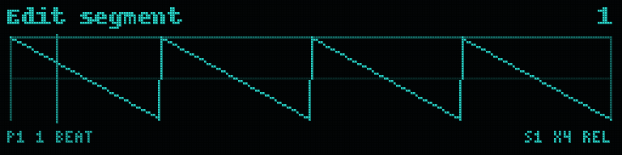

# Shape LFO

*A clocked shape sequencer for the Expert Sleepers disting NT.*

Shape LFO is a clocked modulation sequencer for the Expert Sleepers disting NT. Instead of one repeating waveform, you build a **chain of up to 32 shape segments**. Each segment has its own waveform, length, repeats and sculpting. The chain can loop, ping-pong, fire once per trigger like an envelope, or step forward one segment per trigger, all in time with the internal tempo, a CV clock or MIDI clock. A second output turns the movement into gates and triggers. Sixteen patterns live in one Shape LFO, switchable in time by hand, CV or trigger, and everything is saved with your NT preset.

Version 0.13.2

---

## Installation

1. Download `shape_lfo.o` from the [latest release](https://github.com/intowhite/shape-lfo/releases/latest).
2. Copy it to the `/programs/plug-ins/` folder on the disting NT's microSD card.
3. Restart the NT, then add **Shape LFO** from the algorithm list (it is under Utility).

---

## Quick start

A new Shape LFO opens on the **Edit** page with **Edit segment** selected and plays a 4-segment, one-bar pattern at 120 BPM on Output 1:

| Segment | Shape | Repeats |
|---|---|---|
| 1 | Ramp down | 1 |
| 2 | Ramp down | 4 |
| 3 | Sine | 1 |
| 4 | Ramp up | 1 |

Turn **Edit segment** to choose a segment, then change its **Shape**, **Duration** and **Repeats**. The display redraws the whole pattern as you edit. Use **Add/remove** to change how many segments there are.

---

## The display

- The **waveform** fills the screen and shows the real output voltage for the whole pattern. Each segment's width matches its musical length.
- Thin vertical lines mark segment boundaries. The **selected segment** is outlined.
- A vertical **playhead** shows the current position.
- **Patterns of more than 4 segments** zoom in: the screen shows **4 segments around Edit segment**, so turning Edit segment scrolls through the pattern. A thin **overview strip** along the top shows the whole pattern, with a bracket marking the part on screen and a tick for the playhead, which stays visible there even when the playhead is outside the window.
- **Bottom left:** the playing pattern (`P3`, or `P3>5` while a switch to pattern 5 is waiting for the pattern start; `C2` shows the chain step when the experimental chainer is on), then the pattern length (for example `1 Bar` or `1 Bar 2 Beats`). With an external clock it also shows the clock status: `CV 120` or `MIDI 120` for the measured tempo, `--` when no clock is arriving, `MIDI STOP` after a MIDI Stop.
- A **dotted line** shows the gate threshold when the gate output is assigned and in a threshold mode.
- **Bottom right:** the play mode (when it is not Loop: `1SHOT`, `STEP`, `PING` or `SLOOP`), then the selected segment, its repeats and timing mode, for example `S2 x4 REL`.

---

## Edit page: shaping a segment

Every control on this page applies to the **selected segment only**. The page shows just the controls that apply to the current shape, plus those its **Morph to** shape needs (for example, Morph to Square adds Pulse width).

| Control | Range | What it does |
|---|---|---|
| **Edit segment** | 1–32 | Chooses which segment you are editing. |
| **Shape** | see below | The segment's waveform. |
| **Refresh** / **Regenerate segment** / **Random steps** | see *Random segments* | Random and Smooth random only. |
| **Pulse width** | 5–95% | Square only. |
| **Steps** / **Contour** | 2–16 / Up, Down, Hump, Valley | Steps only. The number of stairs and the staircase's overall direction. |
| **Curve** | −100 to +100 | Ramps and Steps. See *Curve* below. |
| **Duration** | see Timing | Length of the segment, including all of its repeats. |
| **Repeats** | 1–8 | How many times the shape plays within that duration. |
| **Timing** | Follow base / Fixed note | How Duration is set. See *Timing*. |
| **Depth** | 0–100% | The segment's own level. |
| **Pinch** | Left 100% … None … Right 100% | Fades the segment's amplitude in (Left) or out (Right) across the segment, continuously through all of its repeats. |
| **Pinch height** | Down 100% … Center … Up 100% | The voltage the shape shrinks toward when pinched or turned down: the top, the middle or the bottom of the output range. |
| **Warp** | −45 to +45 | Pushes the shape's timing earlier or later within each repeat, without changing the segment's length. |
| **Squish** | −100% to +100% | Compresses and stretches time smoothly within each repeat, for a swung or lopsided feel. |
| **Morph to** | Off or any shape | *Experimental.* A second shape this segment blends toward as the Pattern page's **Morph** control is turned up. See *Morphing*. |
| **Gate trigger** | On / Off | Shown when the gate output is in Segment start or Every repeat mode. Off silences the gate for this segment, turning the gate into a trigger sequencer that follows your shapes. |
| **Duplicate segment** | confirm | Inserts a copy of the selected segment right after it (the following segments move along one place) and selects the copy, ready to edit. Not available when the pattern already has 32 segments. |
| **Delete segment** | confirm | Removes the selected segment; the following segments move back to close the gap. The last remaining segment cannot be deleted. |
| **Reset segment** | confirm | Returns the selected segment to default settings. |
| **Add/remove** | 1–32 | Sets the number of segments from the end. Added segments start with default settings, and the newest one is selected. |

Duplicate, Delete and Reset are confirm controls: select one and press to confirm, so scrolling past them never changes anything.

### Shapes

| Shape | Description |
|---|---|
| Ramp down / Ramp up | Saw ramps, bendable with Curve. |
| Sine | Smooth sine. |
| Square | Square or pulse, with Pulse width. |
| Triangle | Rising then falling. |
| High / Low | A constant top or bottom voltage. Useful as holds and rests. |
| Steps | A staircase of 2–16 levels. **Contour** sets its overall direction: Up, Down, Hump (up then down) or Valley (down then up). |
| Random | A new random voltage on each step (sample-and-hold). |
| Smooth random | Random values with smooth glides between them. |

### Curve

- **Ramps:** positive values give a slow start and fast finish; negative values give a fast start and slow finish.
- **Steps:** at 0 the stairs are hard-edged. Negative values scoop each stair downward. Positive values first round the corners into the next stair, then, towards +100, turn each stair into its own arch. The arches always bow the same direction on the way up and on the way down.

### Timing

- **Follow base:** Duration is a multiple of the **Base division** (Pattern page): ×1/4, ×1/2, ×1, ×2, ×4 or ×8. Change the base division and every segment that follows it scales together.
- **Fixed note:** Duration is a note length that ignores the base division: 1/32 up to 4 bars, each with a triplet (T) version.

Triplet lengths are exact, so straight and triplet segments stay locked together.

---

## Random segments

When Shape is Random or Smooth random, these controls appear directly under Shape. They also appear when **Morph to** is Random or Smooth random, and then control the Morph to target's random values. (A Random segment can morph to Smooth random: the Morph control then sets how smoothly the same values glide.)

| Control | What it does |
|---|---|
| **Refresh** | **Free** (default): new random values every time the segment starts. **Loop**: keeps the current values, so the segment repeats the same random pattern. Switching from Free to Loop captures whatever is playing. |
| **Regenerate segment** | Loop mode only. Asks for new values for this segment. (In Free mode the segment already gets new values every time it starts.) |
| **Random steps** | 1–16 values per repeat (default 1). With 1, the segment holds a single random voltage for its whole length. |

**Regeneration is always on the beat.** Pressing Regenerate, Regenerate all, or sending a regenerate trigger never changes the sound immediately. The new values arrive when the pattern next returns to segment 1, or on a Reset. Several requests before that point count as one.

---

## Pages at a glance

| Page | Contents |
|---|---|
| **Edit** | Everything about the selected segment (see above). |
| **Pattern** | Pattern, Play mode, Segments, Base division, Morph, Regenerate all, Pattern loop start, Pattern loop end, Copy to, Copy pattern, Init pattern |
| **Output** | Voltage range, Amplitude, Offset, Output slew, Quantize, Root |
| **Gate** | Gate out, Gate mode, Gate threshold, Gate out mode |
| **Clock** | Clock source, Internal BPM, Mult/div, Clock PPQN |
| **Routing** | CV out, CV out mode, Gate out, Gate out mode, Clock in, Reset in, Trigger in, Pattern CV in, Next pattern in, Regenerate in |
| **Chain** | *Experimental:* Chain, Chain length, Chain step, Step pattern, Step repeats |

---

## Pattern page

| Control | Range | What it does |
|---|---|---|
| **Pattern** | 1–16 | The pattern that plays and that you edit. Changing it switches at the next pattern start. |
| **Play mode** | Loop, One-shot, Step advance, Ping-pong, Step loop | How the pattern plays. See below. |
| **Segments** | 1–32 | How many segments play. Lowering it hides the segments at the end without erasing them, so raising it again brings them back. |
| **Base division** | 1/32 … 1 bar, with triplets | The note value that "Follow base" segments are measured in. Default 1/4. |
| **Morph** | 0–100% | *Experimental.* How far every segment with a **Morph to** shape has blended toward it. Map it to a CV input for movement. |
| **Regenerate all** | confirm | New values for every Random and Smooth random segment, together, at the next pattern start. |
| **Pattern loop start** / **Pattern loop end** | 1–16 / 1–16 | The patterns that **Next pattern in** steps through. Each trigger moves to the next pattern in the range and wraps back to the start; set 1 and 2 to flip between two patterns. Default 1–16. |
| **Copy to** / **Copy pattern** | 1–16 / confirm | Copies the playing pattern, with all its settings, into another pattern slot. |
| **Init pattern** | confirm | Returns the playing pattern to the factory default (4 segments, 1/4 base, Loop). Other patterns are not touched. |

Segments, Play mode and Base division belong to each pattern, so every pattern can have its own length, timing and play mode.

### Patterns

Shape LFO holds **16 patterns**. Each one keeps its own segments (including Loop-mode random values), segment count, base division and play mode. Clock, output, gate and routing settings are shared by all patterns.

**Switching is always in time.** A new pattern starts at the next pattern start: when the current pattern loops (Loop), at the end of a full forward-and-back cycle (Ping-pong), on the next trigger (One-shot), on the trigger that returns to segment 1 (Step advance), or on a Reset. Until then the display shows `P1>3`. Your edits to the pattern you leave are kept.

Three ways to switch:
- Turn **Pattern**.
- **Pattern CV in:** one semitone per pattern, starting at 0 V: 0 V = pattern 1, 1/12 V (one semitone) = pattern 2, … 1.25 V = pattern 16. Any quantized sequencer or MIDI-to-CV interface can pick patterns by note: C = 1, C# = 2, and so on up the octave.
- **Next pattern in:** each trigger moves to the following pattern within **Pattern loop start–end** (default 1–16), wrapping back to the start of the range. If the playing pattern is outside the range, the first trigger goes to the range start. Several triggers before the switch add up. Pattern CV is not limited by the range.

To build a new pattern from an existing one, select the source pattern, set **Copy to**, confirm **Copy pattern**, then switch to the copy.

### Play modes

**Loop** (default) plays the pattern over and over.

**One-shot** waits, holding the voltage where the pattern ends. Each trigger on **Trigger in** plays the pattern once from segment 1, and then it holds again. A trigger that arrives while the pattern is still playing **restarts it straight away**, like a retriggered envelope.

**Step advance** plays one segment per trigger. Each trigger moves to the next segment, which plays once at its own length and then holds its final voltage until the next trigger. A trigger that arrives mid-segment jumps straight to the next one. After the last segment it goes back to segment 1.

**Ping-pong** plays forward through the segments, then backward through them in reverse order. Each segment also plays backwards in time, so the second half is an exact mirror of the first. One full cycle lasts twice the pattern length.

**Step loop** is Step advance for LFOs: each trigger moves to the next segment, and that segment keeps looping until the next trigger. When first loaded it starts looping segment 1 straight away.

**All modes follow the tempo.** With Internal clock they run at Internal BPM. With a CV or MIDI clock they follow the measured tempo, so a one-shot pattern stretches and shrinks with your clock. A trigger starts playback immediately; it does not wait for the next clock pulse. If the external clock stops, playback pauses until it resumes.

**Good to know:**
- When first loaded in One-shot or Step advance, Shape LFO waits for a trigger.
- Switching from Loop to One-shot finishes the current pass, then holds. Switching back to Loop resumes immediately.
- Reset in also restarts One-shot and Step advance from segment 1. MIDI Start does the same.
- Trigger in has no effect in Loop and Ping-pong.
- Step loop starts each loop of its segment as a new segment, so Segment start gate triggers fire on every loop.
- Random regeneration still waits for a pattern start: a restart in One-shot, the return to segment 1 in Step advance, or the start of a new forward pass in Ping-pong.

---

## Output page

| Control | Range | What it does |
|---|---|---|
| **Voltage range** | −5 to +5 V, 0 to 5 V, 0 to 10 V | CV output range. |
| **Amplitude** | 0–100% | Overall level. The waveform shrinks toward each segment's Pinch height point. |
| **Offset** | −5 V to +5 V | Added to the CV output. |
| **Output slew** | Off, 1 ms … 1000 ms | Smooths jumps such as square edges, steps and random changes. |
| **Quantize** | Off, Major, Minor, Major pent, Minor pent, Dorian, Mixolydian | Snaps the CV output to the notes of a scale (1 V/octave). Off by default. |
| **Root** | C … B | The key of the scale. 0 V is C. |

### Quantize

With **Quantize** on, the CV output becomes a melody: every voltage is snapped to the nearest note of the chosen scale, in **Root**'s key, at 1 V per octave with 0 V = C. Steps and Random segments become note sequences; ramps and sines become runs and arpeggios.

- Turn **Amplitude** down to choose the note range. The full ±5 V range covers 10 octaves; 10–20% (1–2 octaves) is a good starting point. **Offset** moves the range up or down.
- **Output slew** comes after the quantizer, so it becomes a glide between notes.
- The display and the gate output use the quantized voltage, so what you see is what comes out.
- For other scales or microtonal tunings, leave Quantize off and use the NT's own Quantizer algorithm after Shape LFO.

---

## Gate page

The second output turns the movement into gates and triggers. Assign **Gate out** here or on the Routing page (it is off by default). Gates and triggers are 5 V; triggers last 10 ms.

| Control | Range | What it does |
|---|---|---|
| **Gate out** | None or any output | Where the gate/trigger output goes. The same setting also appears on the Routing page. |
| **Gate mode** | see below | What the gate output does. |
| **Gate threshold** | 0–100% | Where the threshold modes switch, as a percentage of the Voltage range: 0% is the bottom, 50% (default) the middle, 100% the top. |
| **Gate out mode** | Replace / Add | Replace or add to whatever is already on that bus. Also on the Routing page. |

| Gate mode | Output |
|---|---|
| **Above** (default) | Gate high while the CV is above the threshold. |
| **Below** | Gate high while the CV is below the threshold. |
| **Rising** | Trigger each time the CV crosses the threshold going up. |
| **Falling** | Trigger each time it crosses going down. |
| **Both** | Trigger on every crossing. |
| **Segment start** | Trigger at the start of every segment whose **Gate trigger** (Edit page) is On. |
| **Every repeat** | Trigger at the start of every repeat, so a segment with 4 repeats gives 4 triggers (ratchets). Also follows each segment's **Gate trigger**. |
| **Pattern end** | Trigger when a pass finishes: once per loop in Loop, when the shot ends in One-shot, after the last segment in Step advance, and once per full cycle in Ping-pong. |

- The threshold modes compare the CV before Output slew, which is the curve drawn on the display. The **dotted line** shows the threshold.
- A small hysteresis band (2% of the range) is built in, so a shape that sits on or wobbles around the threshold can't chatter.
- **Pattern end** is the end-of-cycle trigger for One-shot. Use it to chain envelopes or to fire another Shape LFO.

---

## Clock page

| Control | Options | What it does |
|---|---|---|
| **Clock source** | Internal, CV clock, MIDI clock | Where the tempo comes from. |
| **Internal BPM** | 20–300 | Tempo when Clock source is Internal. |
| **Mult/div** | /4, /3, /2, x2/3, x1, x3/2, x2, x3, x4 | Runs the whole pattern slower or faster than the clock, with every segment (including Fixed-note ones) scaled together. Works with the internal clock and CV/MIDI clock; x1 is normal. x3 and x2/3 give polyrhythms against the clock. |
| **Clock PPQN** | 1 (1/4), 2 (1/8), 4 (1/16), 8 (1/32), 12, 24, 48 | Pulses per quarter note of your CV clock. Default 4 (16th notes). |

Assign the clock and reset inputs on the **Routing** page.

**Following an external clock.** Shape LFO locks to the clock without drifting. Each pulse lines the pattern up exactly with the beat, and between pulses it moves at the measured tempo. If the clock stops, the LFO stops on the next beat and waits, then carries on when the clock comes back. Tempo changes are followed within a pulse or two. Higher PPQN settings respond more smoothly.

**Reset** jumps straight to the start of segment 1 in every play mode. It works with every clock source, including Internal. With an external clock, playback continues from the next clock pulse; if a clock pulse arrives together with the reset, that pulse is the first beat of the new pass. A reset also counts as the start of the pattern for random regeneration.

**MIDI clock** uses the standard 24 PPQN clock from the NT's MIDI input:
- **Start** returns to segment 1, and the next clock is the downbeat.
- **Stop** holds the output where it is.
- **Continue** resumes from where it stopped.
- If your clock source sends no Start or Stop messages, Shape LFO simply runs with the clock.

---

## Routing page

| Control | What it does |
|---|---|
| **CV out** / **CV out mode** | The CV output (default Output 1). Mode is Replace or Add to whatever is already on that bus. |
| **Gate out** / **Gate out mode** | The gate/trigger output (default None) and its Replace/Add mode. |
| **Clock in** | Input for a CV clock (when Clock source is CV clock). |
| **Reset in** | Restarts the pattern from segment 1. |
| **Trigger in** | Fires One-shot and Step advance. |
| **Pattern CV in** | Selects the pattern: one semitone per pattern from 0 V. |
| **Next pattern in** | Moves to the next pattern on each trigger, within Pattern loop start–end. |
| **Regenerate in** | Does the same as Regenerate all on each trigger. |

All inputs respond to signals rising above 1 V and must fall below 0.5 V before the next trigger counts, so a held gate counts only once.

---

## Experimental features

These two are for trying out and may change or be removed before 1.0. Patches that use them may not load the same way in a later version.

### Morphing

Give a segment a **Morph to** shape on the Edit page, then turn up **Morph** on the Pattern page: the segment blends from its own shape toward the Morph to shape. 0% is the original shape, 100% is the Morph to shape, and every segment with a Morph to shape follows the same Morph control. Map **Morph** to a CV input (NT parameter mapping) to sweep it with an LFO or envelope. The blend uses the segment's own Curve, Pulse width, Steps, Contour and random values for both shapes; the controls the Morph to shape needs appear on the Edit page. A Random or Smooth random Morph to target follows **Refresh** like a Random segment: new values each time the segment starts in Free, or held values (with Regenerate) in Loop. Morphing costs extra CPU while Morph is above 0.

### Pattern chainer (Chain page)

| Control | What it does |
|---|---|
| **Chain** | Off / On. On plays the chain, starting with step 1 at the next pattern start. |
| **Chain length** | 1–8 steps. |
| **Chain step** | Which step you are editing. |
| **Step pattern** / **Step repeats** | The pattern for that step and how many whole passes it plays (1–16). |

The chain switches patterns at pattern starts, like every other pattern change. Reset (or MIDI Start) goes back to step 1. While the chain runs it decides the pattern; Pattern CV and Next pattern changes are overridden at the chain's next step. The display shows the chain step as `C2`.

## Tips

- Use **High** and **Low** segments as rests and holds between moving shapes.
- A **Ramp** with **Repeats 4** and **Pinch Right** makes a decaying burst. Try it on a VCA or filter.
- **One-shot** turns a pattern into a clock-synced multi-stage envelope. Fire it from a gate or drum trigger.
- **Step advance** with a sequencer's gates gives every note its own modulation shape.
- Set Random to **Loop** for a repeatable "random" phrase. Send a trigger to **Regenerate in** at the end of a section to get a new phrase on the next downbeat.
- **Output slew** of 5–20 ms takes the click out of hard edges without softening the rhythm.
- **Every repeat** on a segment with several repeats makes ratchet bursts for a drum module.
- **Quantize** a Random segment set to Loop for a repeating melody; Regenerate gives you a new one on the next bar.
- To build variations quickly, **Duplicate** a segment and change just one thing on the copy.
- **Above** with a slow shape gives you a gate whose length follows the shape: move the threshold to change the duty cycle.

---

## Saving your patterns

All 16 patterns are saved inside your disting NT preset, along with every other setting.

- **Save the preset** as usual: **Presets → Save preset**. The NT never saves automatically, so anything changed since your last save is lost at power-off.
- **To keep a pattern library**, use **Presets → Save single algorithm preset** with Shape LFO selected. This saves just Shape LFO, with all 16 patterns, as its own preset file. Bring it into any setup with **Presets → Append preset** (or Insert / Prepend), which adds it alongside the algorithms already loaded.
- **To come back to where you left off after power-up**, turn on **Settings → Startup → load the most recently used preset**. It loads your last *saved* preset, so save before switching off.

## Roadmap

See [ROADMAP.md](ROADMAP.md) for what is planned before and after version 1.0.

## Issues and feedback

Report bugs and suggest features on [GitHub Issues](https://github.com/intowhite/shape-lfo/issues).

## Building from source

See [DEVELOPMENT.md](DEVELOPMENT.md).

## License

MIT. See [LICENSE](LICENSE).
